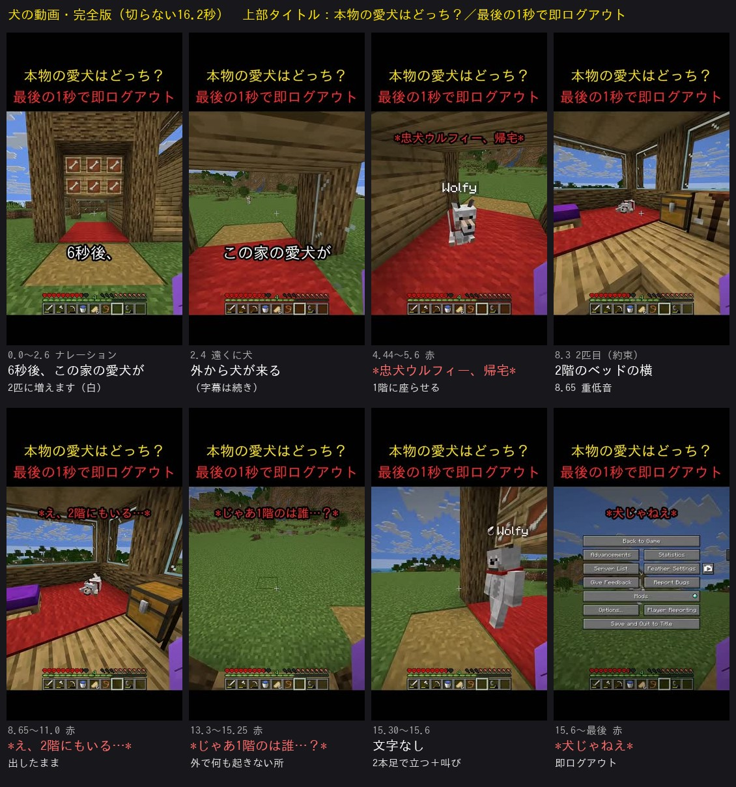

# 犬の動画（That was not my dog）・完全版（2026-11-28）

これが決定版。考えた経緯は `plan.md`、見本は `tools/dog_cut.py`（`CUT_MODULE=dog_cut python3 tools/noads_sample.py …`）。

---

## 1. 決定した中身

| | 中身 |
|---|---|
| 切り方 | **切らない**（0〜16.23秒・等倍） |
| 上部タイトル | **本物の愛犬はどっち？**（黄）／**最後の1秒で即ログアウト**（赤）。Gemini も採用で一致 |
| ナレーション | **6秒後、この家の愛犬が2匹に増えます。**（VOICEVOX 四国めたん・2.5〜2.7秒。11/28 に「8秒後」から変更：7章） |
| 赤文字 | 4.44 \*忠犬ウルフィー、帰宅\* → 8.65 \*え、2階にもいる…\* → 13.3 \*じゃあ1階のは誰…？\* → （15.30 文字なし）→ 15.6 \*犬じゃねえ\* |
| 投稿タイトル | **マイクラで帰ってきた愛犬が怖すぎる…**（18字）。Gemini と一致 |
| 固定コメント | **1階と2階、どっちが本物だと思った？** |
| カバー | 4.8秒のコマ（名札の犬がこちらを向いて座る） |

---

## 2. 秒ごとの完全な表（この秒どおりに入れる）

| 秒 | 画 | 文字 | 声・音 |
|---|---|---|---|
| 0.0〜0.6 | 骨を飾った2階建ての犬小屋（階段も見える） | 「6秒後、」（白） | ナレーション開始。元の音は 40〜50% |
| 0.6〜1.6 | 小屋の中から外を見る | 「この家の愛犬が」（白） | |
| 1.6〜2.6 | 同上。2.4秒に遠くに犬 | 「2匹に増えます」（白） | ナレーション終わり。元の音を100%に戻す |
| 2.6〜4.4 | 犬が外から近づく | なし | |
| 4.44〜5.6 | 名札「Wolfy」の犬が入り、座らせる | **\*忠犬ウルフィー、帰宅\***（赤） | |
| 5.6〜8.2 | 1階を見回す → 階段で2階へ（犬は1階に座ったまま） | なし | |
| 8.3 | **2階のベッドの横にもう1匹**（1段目・約束の「6秒後」。頭から+2.3秒、ナレーションが終わってから5.7秒） | | |
| 8.65〜11.0 | 同上 → 寝ている犬に近づく | **\*え、2階にもいる…\***（赤・出したまま） | 8.65・9.7 重低音（そのまま） |
| 11.0〜13.3 | 2階の出口から外へ | なし | |
| 13.3〜15.25 | 野原を見る → 14.85 振り返る | **\*じゃあ1階のは誰…？\***（赤） | |
| **15.30〜15.6** | **1階の犬が2本足で立つ**（2段目） | **なし** | 叫び声のような音（そのまま・一番大きい） |
| 15.6〜16.23 | 走って逃げる → 15.85 メニュー → タイトル画面 | **\*犬じゃねえ\***（赤） | |

- ループ：タイトル画面（16.23）→ 頭の犬小屋（0.0）。「この家の愛犬」に戻るので、2周目は1階の犬を疑って見る
- 元の英語の字幕「That was not my dog」（元の動画で上から166〜215px）は、上部タイトルの黒帯で必ず隠す

---

## 3. Gemini の「最強ハイブリッド」との違い（残った2か所）

### 3-1. ナレーション

| 案 | 約束の中身 | 0秒の画との対応 | 上部タイトルとのつながり | 2階の犬に気づけるか |
|---|---|---|---|---|
| **6秒後、この家の愛犬が2匹に増えます。**（こちら） | 出来事（2匹に増える）＝本当に2匹出て確かめられる | ◎「この家」＝0秒に映っている家 | ◎「2匹」→「本物はどっち？」が初めからつながる | ◎ 2匹目を探して見るので、奥で小さく寝ている犬にもすぐ気づく |
| 8秒後、この愛犬のせいで背筋が凍ります。（Gemini ①） | 気持ち（背筋が凍る） | △「この愛犬」と言う時、犬は映っていない（2.4秒から） | △「どっち？」が何と何か分からないまま | △ 前振りがないと、2階の犬が「ついてきただけ」に見えるおそれ |
| 8秒後、この愛犬の異常に気づきます。（Gemini ②） | 気づき（異常） | △ 同上 | ○ | ○ |

**公平に言うと**：
- 気持ちを約束する形（Gemini ①）も当たっている。宝箱「5秒後、この男の狂気に鳥肌が立ちます」は最初の1.5秒で 83%
- ただし宝箱は、0秒に「この男」の顔が映っていた
- この動画は、2階の犬が暗い部屋の奥に小さく寝ているだけ。そこで「2匹になる」と先に言っておく方が、1段目が確実に伝わる
- ベリティの「全部消えます」（出来事を約束する形）が 81.4% なのも、こちらの形

### 3-2. 赤文字

| 秒 | Gemini | こちら | 理由 |
|---|---|---|---|
| 4.4 | 愛犬のウルフィー | \*忠犬ウルフィー、帰宅\* | どちらも名前を覚えさせる。こちらはあだ名（忠犬）とかしこまった言い方で笑いになり、偽物と分かると皮肉になる（SMP：あだ名はそれ自体が笑い・丁寧語の落差） |
| 8.65 | \*え、2階にもいる…\* | 同じ | 一致 |
| 10.35〜15.3 | **文字なし（約5秒）** | 13.3〜15.25 \*じゃあ1階のは誰…？\* | 外を歩くだけの所。SMP「何も起きない所は1枚を長く出す」（\*こ、こない\* を6秒）。2段目の直前に「1階の方を見て」と渡すので、0.5秒の動きを見逃さない |
| 15.3 | \*二足歩行で逃走\*（オチの瞬間に重ねる） | 文字なし → 15.6 \*犬じゃねえ\* | 画面を見れば分かる事は書かない（SMP の分析）。オチの瞬間は飛ばさず見せる（Dream：見せた #30 は 466万、「数分後…」で飛ばした #25 は 87万）。最後は一言ツッコミ（Dream 58本中33本） |

---

## 4. 声・音

| | 中身 |
|---|---|
| 声 | VOICEVOX 四国めたん（いつもの声） |
| 読み | ろくびょうご、このいえのあいけんが、にひきにふえます。（「6秒後」「愛犬」「2匹」の読みを確かめる） |
| 長さ | 2.5〜2.7秒（ベリティは17字で2.36秒） |
| 元の音 | ナレーションの間（0〜2.6秒）だけ 40〜50%。そのあとは100%（元の動画は −19.5 LUFS と小さめ。ベリティのように全体を下げなくてよい） |
| 重低音（8.65・9.7）と叫び（15.30） | **触らない**。1段目と2段目の合図 |
| ドクタードーナツ | この動画への**本人の反応があるときだけ**、左上に（0秒に顔が入ると強い：宝箱 83%）。無ければ入れない |

---

## 5. 投稿まわり

| | 中身 |
|---|---|
| 投稿タイトル | マイクラで帰ってきた愛犬が怖すぎる…（16〜18字・「マイクラ」・「…」・上部タイトルと「愛犬」が重なる・ネタバレなし） |
| 説明欄 | #マイクラ #マインクラフト ＋ いつものクレジット（VOICEVOX:四国めたん） |
| 固定コメント | 1階と2階、どっちが本物だと思った？（上部タイトルの問いの続き。答えるコメントが付きやすい） |
| カバー | 4.8秒のコマ |

---

## 6. 見込みと、出したら見ること

- 視聴を継続：**72〜80%**。0秒に顔がないので、ベリティ（81.4%）より少し下がるかもしれない
- 平均視聴割合：**120〜160%**（16.2秒・2段オチ・ループで2周目を見たくなる）
- **推定で、保証はできない**

出したら見ること：
1. 視聴を継続が 75% を超えるか（下回れば、0秒の画が弱い。次はドクタードーナツの反応がある素材を選ぶ）
2. 維持率グラフで、8.3秒（2匹目）のあとに落ちていないか、11〜13秒（外へ出る所）に段差がないか
3. 最後でループして、100% を超える所があるか

---

## 7. 「8秒後」か「6秒後」か（11/28・ユーザーの指摘「長いと思われてスクロールされない？」）

### 7-1. 待つ間にどれだけ離れるか（Studio の維持率から）

| | 最初の1.5秒 | ナレーション終わり | 約束 | オチ | 待ち（ナレーション後） | 待つ間 1秒あたり |
|---|---|---|---|---|---|---|
| 宝箱 | 83% | 2.7秒 | 5秒後 | 6.9秒 | 4.2秒 | **2.05%** |
| 古参 | 75% | 3.5秒 | 8秒後 | 9.0秒 | 5.5秒 | **2.05%** |
| 階段 | 82% | 1.5秒 | なし | 10.0秒 | 8.5秒 | 2.85% |

- **待つ間の離れ方は「5秒後」と「8秒後」で同じ**（1秒あたり2.05%）。数字が大きいから待つ間に離れる、という事は起きていない
- 秒の約束がある方が、ない（階段）より待つ間に離れにくい（2.05% と 2.85%）
- 古参が最初の1.5秒で落ちたのは、「古参なら」で見る人を絞ったことと、ナレーションが3.5秒と長かったことが大きい。数字の8だけのせいとは言えない
- この動画は、ナレーション後の待ちが約5.7秒（宝箱より1.5秒長い）。待つ間に離れる人は、宝箱より約3ポイント多くなる見込み。**これは数字を何にしても変わらない**（オチは8.3秒で動かせない）

### 7-2. 数字の合わせ方（100万超えの作り方）

| | 約束 | オチ | 頭から数えたずれ | ナレーション後から数えたずれ |
|---|---|---|---|---|
| 宝箱 | 5秒後 | 6.9秒 | +1.9秒 | −0.8秒 |
| ベリティ | 5秒後 | 7.0秒 | +2.0秒 | −0.4秒 |
| 古参 | 8秒後 | 9.0秒 | +1.0秒 | −2.5秒 |
| 犬（5秒後なら） | | 8.3秒 | +3.3秒（遅すぎる） | +0.7秒 |
| **犬（6秒後）** | | 8.3秒 | **+2.3秒** | **−0.3秒** |
| 犬（8秒後） | | 8.3秒 | +0.3秒 | −2.3秒 |

- 強かった2本（宝箱・ベリティ）は、**頭から数えると約2秒遅れ、ナレーションが終わってから数えるとほぼ同じ**
- 「6秒後」はこの合わせ方と同じ。「8秒後」は古参の合わせ方
- 小さい数字の方が「すぐ来る」と聞こえる。ただし、数字だけの効き目はデータでは確かめられていない
- 「5秒後」は、頭から数えて3.3秒遅れになり、100万超えの範囲（1.0〜2.0秒）を超えるので使わない

**結論：6秒後にする。**
