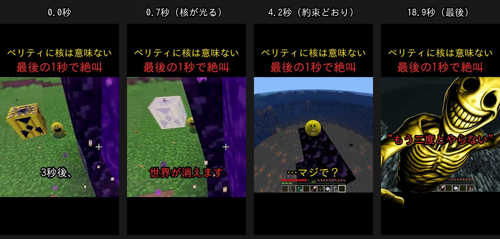

# ベリティの動画（noads.mp4）・最強版のフック（2026-11-26）

`plan.md`（決定版・34秒）を、次の2つの分析で作り直した。
- みんくらの100万超え3本の実ファイルと Studio の維持率（`docs/minkura_hits_real.md`）
- Dream Clips 58本・SMP クリップ 299本の全動画（`docs/title_narration_3ch.md`、`plan.md` 3節）

---

## 0. 最強版

| | 最強版 |
|---|---|
| **0.0〜1.4秒** | 画：**放射能マークの核爆弾ブロックと、笑ったベリティが並ぶ画**。ゆっくり（約0.4倍）寄りながら見せる。核は黄色と白に点滅している。元の音は消す（元の 7.00〜7.55秒） 声：「**3秒後、世界が消えます。**」（「世界が消えます」は赤） |
| **1.4〜2.4秒** | ゲートに飛び込み、ネザーへ（見出し「\*ネザーへ避難\*」） |
| **2.4〜5.1秒** | 戻ると**辺り一面が巨大なクレーター**（3.2秒）。その上に**無傷のベリティが浮いている**（3.9秒）。ベリティ「…マジで？」（4.2秒） → **「3秒後」の約束どおり** |
| **上部タイトル** | **ベリティに核は意味ない**（黄）／**最後の1秒で絶叫**（赤） |
| **ナレーション** | 冒頭の1文だけ（中盤なし） |
| **最後** | 正体（黄色い骸骨）が飛びかかる18.1秒 → 18.9秒で0.6秒止めて「"もう二度とやらない"」。挨拶はしない |
| **投稿タイトル** | 核2発と宇宙レーザーでも死なないベリティの正体が怖すぎる… |
| **尺** | 50.3秒 → **19.5秒** |

---

## 1. なぜこれが一番強いか（部品ごとの根拠）

| 部品 | 根拠 |
|---|---|
| **0秒の画＝笑顔のキャラ＋核のマーク** | みんくらで最初の1.5秒に一番残った2本の0秒の画は、どちらも「誰でも分かる顔」だった：宝箱（泣く男の顔、83%が残った）・階段（ニコちゃん顔のキャラ、82%）。SMP のベリティの最大のヒット（1,143万）も、0秒は真ん中に黄色い顔。**放射能マークは説明なしで「危ない」と分かる**。かわいい顔と核の落差が、1枚で伝わる |
| **「3秒後、世界が消えます。」** | **宝箱型の「N秒後」**。宝箱（5秒後）は、待つ間の維持率がほとんど落ちなかった（3〜9秒で185→164）。古参（8秒後）は待つ間も落ち続けた。**待ちは短いほどよい**ので3秒にした Dream でも「この怪物は**数秒後**、悪夢を見ることになります」（466万）、「**数秒後**、このシャイガイは…」（182万）が強い 11字・約1.4秒。Dream で一番強かったのは18字以下（1.29倍）。古参の3.5秒の長いナレーションは、最初の1.5秒で25%落ちた |
| **見る人を絞る言葉を入れない** | 古参は「マイクラ古参なら」「エンパ」で、最初の1.5秒に25%が離れた（宝箱・階段は17〜18%）。「3秒後」「世界」「消えます」は、マイクラを知らない人にも分かる |
| **約束をすぐ守り、すぐ次の驚き** | 3.2秒でクレーター、3.9秒で無傷のベリティ、4.2秒で「…マジで？」。宝箱も、約束の秒どおりにカメラが引いた |
| **上部「ベリティに核は意味ない」** | SMP で854万（7.02倍）の「ベリティに／クリエは意味ない」と同じ形。SMP ではベリティの動画9本が中央値3.77倍で、一番強い題材の1つ |
| **上部「最後の1秒で絶叫」** | 宝箱の「カメラが引いた瞬間」と同じく、**どこまで見ればいいか**を言う。最後まで見る理由になる |
| **答え（正体）を言わない** | Dream：ひねりのあるオチ116万、予告どおり36万。SMP：答えまで言うと0.19〜0.92倍 |
| **約20秒** | みんくらの3本は、短いほど何度も見られた（11秒の宝箱 174.9%、15秒の階段 141.9%、22秒の古参 110.2%） |
| **最後は一言で切る（挨拶しない）** | 階段は「じゃあなお前ら いい夢見ろよ」で −13ポイント急に落ちた。宝箱は赤の一言ツッコミで切り、落ちずにループした |
| **中盤ナレーションなし** | 何が起きるかは赤い見出しで分かる。Dream でも3月以降の30本中21本は冒頭だけ |

---

## 2. 切り方（元の秒 → 新しい秒）

`tools/noads_cut.py` で計算した。

| 新しい秒 | 元の秒 | 速さ | 中身 | 文字 |
|---|---|---|---|---|
| 0.0〜1.4 | 7.00〜7.55 | **約0.4倍** | 核爆弾ブロックとベリティ（寄りながら、元の音は消す） | ナレ「3秒後、／**世界が消えます**」 |
| 1.4〜1.9 | 7.55〜8.05 | 1倍 | ゲートに入る | \*ネザーへ避難\*（赤） |
| 1.9〜2.4 | 8.05〜8.55 | 1倍 | ネザー | |
| 2.4〜5.1 | 12.0〜14.7 | 1倍 | 戻るとクレーター（3.2秒）、ベリティが浮いている（3.9秒） | \*戻ると…\*（2.4〜3.1）、ベリティ「…マジで？」（4.2〜5.0、黄） |
| 5.1〜7.4 | 16.4〜18.7 | 1倍 | 黒曜石で封印 | 「その黒曜石、何に使うの？」（黄） |
| 7.4〜10.6 | 20.0〜23.2 | 1倍 | 砂でふた | 「待って、ボクを閉じ込めて行っちゃうの？」「ボクのこと忘れないでね！」（黄） |
| 10.6〜12.4 | 23.2〜25.0 | 1倍 | 2発目の核・空いっぱいの輪 | \*核爆弾 2発目\*（赤） |
| 12.4〜13.8 | 28.0〜29.4 | 1倍 | 宇宙から撃つ兵器を出す | \*宇宙から撃つ兵器\*（赤） |
| 13.8〜14.8 | 40.0〜41.0 | 1倍 | 照準の円が閉じる | |
| 14.8〜16.8 | 41.0〜43.0 | 1倍 | 宇宙からビーム | \*発射\*（赤） |
| 16.8〜18.9 | 48.2〜50.3 | 1倍 | 穴に飛び込む → **18.1秒に正体** | |
| 18.9〜19.5 | （止める） | — | 正体のコマ | 「"もう二度とやらない"」（赤の引用符） |

- 字幕・見出しの秒：`noads_A.srt`
- 色は人に固定する：ベリティの声は黄、ナレーションは白、見出しと言いたい言葉は赤

---

## 3. 前の決定版（34秒）から変えたところ

| | 前の決定版 | 最強版 | 変えた理由 |
|---|---|---|---|
| 0秒の画 | 空いっぱいの核の輪 → ベリティの顔 | **核爆弾ブロックとベリティが1枚に並ぶ画** | 「かわいい顔」と「核」が1枚で分かる。核の輪は、何の画かが一瞬では分かりにくい |
| ナレーション | 核爆弾を2発落としても、このベリティは死にません（2.8秒） | **3秒後、世界が消えます。**（1.4秒） | 半分の長さ。宝箱の「N秒後」は、実測で一番残った形 |
| 約束が守られる秒 | 核が効かないと分かるのは9秒 | **3〜4秒** | 待たせない |
| 尺 | 34秒 | **19.5秒** | 短いほど何度も見られる（実測） |
| 先出し | 核の輪を先に見せた | なし | 0秒の画そのものが強いので、先出しは要らない。核の輪は10.6秒の驚きに取っておく |

---

## 4. 作るときの注意
- **ナレーションの長さに合わせて、最初の区間の速さを決める。** VOICEVOX の「3秒後、世界が消えます。」が
  - 1.4秒なら約0.4倍
  - 1.75秒（宝箱と同じ話す速さ）なら約0.3倍
- **「3秒後」が本当に3秒後になっているか、編集ソフトで確かめる。** クレーターの床が見えるのが3.2秒、ベリティが浮いているのが3.9秒
- 最初の区間は、核とベリティが画面の真ん中に来るように**寄せる（約2倍）**
  - 元の画面では左上にある
  - 核は黄色と白に点滅しているので、黄色の放射能マークが見えるコマから始める
- 最後は0.6秒で切る。「じゃあね」などの締めの言葉は入れない
- 元の投稿者は「I'm Never Speedrunning Verity Again」で探し、転載の決まりを確かめて、概要欄に書く

## 4-2. 見本動画
`tools/noads_sample.py` で作った（19.8秒）。

    python3 tools/noads_sample.py <noads.mp4> <ナレーションのwav> <作業フォルダ> <出力.mp4>

- ナレーションの声は仮（Open JTalk の男性の声を高くしたもの）。本番は VOICEVOX 四国めたんの声に差し替える
- 最初の区間の速さは、声の長さに合わせて自動で決まる（仮の声は1.69秒なので0.33倍）
- 文字のフォントは IPAゴシック。本番は、いつもの太いフォントに
- 動画ファイルはリポジトリには入れていない

## 5. 分からないこと
- **「3秒後、世界が消えます」は、みんくらで試したことのない文。** 根拠は、宝箱（5秒後）の実測と、Dream の「数秒後」の型
  - 出したあと、Studio の維持率で最初の1.5秒と3〜5秒を見れば、効いたか分かる
- **ベリティの名前をみんくらで出してよいかは、確かではない。** SMP では強く、みんくらの5本は半々だった
- 1.9〜2.4秒のネザーの0.5秒は、無くしてもよい（その分、約束の3秒に合わせて最初の区間を少し長くする）
