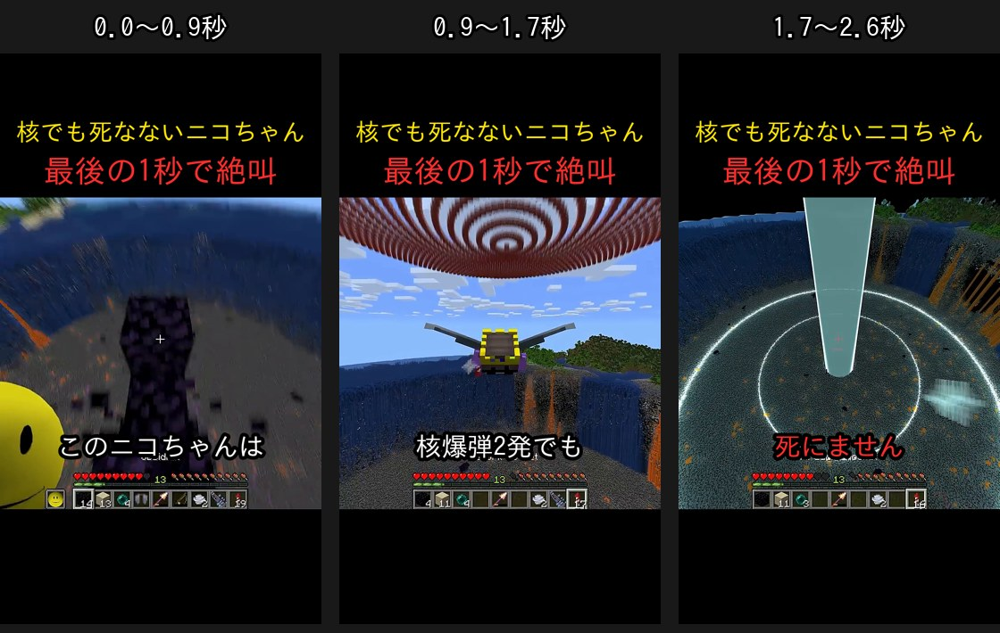
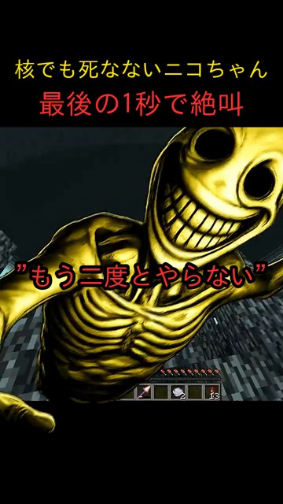

# noads.mp4（ニコちゃん＝ベリティのスピードラン）を出す前の設計（2026-11-25）

ユーザーが「これをあげたい」と送った動画（50.3秒）について、次の3つを決める。
- スクロールを止める冒頭（最初の画・上部タイトル・ナレーション）
- 最後まで見させる中盤とオチ
- 投稿タイトル

**参考にしたもの**
- SMP クリップ・Dream Clips は全動画（SMP 299本、Dream 58本）のうち、**この動画に近いもの**（ベリティ・核・軌道爆撃砲・ホラー・閉じ込め・「〜でも死なない」）
- 3チャンネル（SMP・Dream・みんくら）それぞれの上位3本

数字は「相対再生」（同じチャンネルの前後の動画の中央値を1.0とした倍率）。

**材料**
- 動画は1秒ごとのコマ、22〜50秒は0.5秒ごとのコマを読んだ
- 声は Whisper（英語と判定、確からしさ98%）で書き起こした
- 音量とカットは実測

---

## 0. 結論（推し案A）

| | 案A |
|---|---|
| **最初の2.6秒** | 3つの画を先に見せる：①ニコちゃんの顔 →②空いっぱいの核の輪 →③宇宙からのビーム |
| **上部タイトル** | 核でも死なないニコちゃん（黄）／**最後の1秒で絶叫**（赤） |
| **冒頭ナレーション**（0.0〜2.6秒） | このニコちゃんは／核爆弾2発でも／**死にません**（赤） |
| **中盤ナレーション**（軌道爆撃砲を出す所） | 核でもダメなら、宇宙から撃ちます。 |
| **最後** | 正体のコマを1秒止めて、赤の引用符「"もう二度とやらない"」 |
| **投稿タイトル** | 核2発と宇宙レーザーでも死なないニコちゃんの正体が怖すぎる… |
| **尺** | 50.3秒 → **36.2秒**（何も起きない所を切る。3節） |

- 見本：`hook_A.jpg`（最初の2.6秒）、`end_A.jpg`（最後）
- 字幕・ナレーション・見出しの秒：`noads_A.srt`（切った後の秒）
- 切り方と字幕の秒は `tools/noads_cut.py` で出した

---

## 1. 動画の中身（元の秒）

| 秒 | 映像 | 声（英語 → 訳） |
|---|---|---|
| 0.0〜2 | 草原に段ボール箱。画面の上に英語の題「I'm Never Speedrunning Verity Again....」 | Hello? → もしもし？ |
| 2〜4.5 | 黒曜石と丸石で、すぐネザーゲートを組む（スピードラン） | |
| 3.5〜7.7 | 黄色いニコちゃん（ベリティ）が転がってくる（5秒） | Hello! You already know who I am! I am Verity! → やあ！ボクのこと知ってるよね！ボクはベリティ！ |
| **7.0** | **ニコちゃんの横に、放射能マークの黄色と黒のブロック（核爆弾）を置き**、火打石でゲートに火をつけ、ネザーへ | |
| 8〜12 | ネザー（何も起きない） | |
| **12.2〜14.7** | 戻ると、**辺り一面が溶岩の流れる巨大なクレーター** | Seriously? → …マジで？ |
| 15.5〜21 | ニコちゃんを黒曜石で囲み、砂でふたをする | What are you doing with all that obsidian? / Wait, you are leaving me trapped? Don't forget about me! → その黒曜石、何に使うの？／待って、ボクを閉じ込めて行っちゃうの？ ボクのこと忘れないでね！ |
| **22〜26** | **2発目の核**（22秒に「NUKE POWER 3」と読める表示）。**空いっぱいに赤白の TNT の輪が降ってくる**。エリトラで逃げる | |
| 26〜28 | 木の足場へ移動（何も起きない） | |
| **28.0** | 「**Orbital Railgun**」（軌道爆撃砲）を持つ。緑の照準線 | Let's go!（聞き取りは不確か） |
| 31〜41 | 空に照準の輪 → 暗転して円が縮む（**溜めが約10秒**） | |
| **41** | **宇宙からビーム**。全編で一番音が大きい（41〜43秒、−4dB。ふだんは −8〜−13dB） | |
| 42〜48 | ビームがクレーターの真ん中を掘っていく | |
| 48.2〜49.5 | 掘った穴に飛び込む | |
| **49.5〜50.3** | **黄色い骸骨のような笑顔の怪物が飛びかかってくる（ニコちゃんの正体）**。ここで終わる | |

### この動画の強み
- **エスカレートして、最後にひねりがある**（核 → 封印 → 核 → 宇宙 → 正体）
  - Dream の58本で一番差が大きかったのがここ。ひねりのあるオチは中央値116万、予告どおりのオチは36万
- **かわいさと破壊の落差**：「もしもし？」と話しかけてくる丸いニコちゃんに、核を2発落とす
- **画の規模**：クレーター、空いっぱいの TNT の輪、宇宙からのビーム
- ニコちゃんが自分で名乗るので、**ベリティを知らなくても話が分かる**

### この動画の弱み
- **最初の3秒が「何も無い草原と段ボール箱」**。スクロールされる一番の原因になる
- **長い（50秒）**。ネザー（8〜12秒）・移動（26〜28秒）・暗転の溜め（34〜39秒）は何も起きない
- **一番の見せ場（正体）が最後の0.8秒しかない**。気づく前に終わる
- セリフが全部英語
- 画面の上に英語の題が入っている（上部タイトルで覆う必要がある）

---

## 2. 参考にした動画

### 2-1. SMP・Dream の全動画から、この動画に近いもの

| 近さ | 本数 | 相対の中央値 | 一番伸びた例（相対） | この動画に使うところ |
|---|---|---|---|---|
| **ベリティ**（SMP） | 9 | **3.77** | 上部「ベリ虐という概念」・ナレ「ベリティを58秒間ブチギレさせるという男」（8.79・1,143万） | ベリティは SMP では一番強い題材の1つ |
| **「〜は意味ない・死なない」**（SMP） | 10 | **1.82** | 上部「**ベリティに／クリエは意味ない**」・ナレ「クリエで対抗する男」（7.02・854万） | **「核でも死なない」の言い切り** |
| **核**（SMP） | 2 | 3.4 | 上部「**クリスタル史上／最大の核実験**」（3.67・623万）、「…核実験？」（3.18・334万） | 「核」という言葉 |
| 軌道爆撃砲（SMP） | 5 | 1.03 | ウェンブーの街破壊（1.75・309万）、「ベリティを軌道爆撃砲で破壊する男」（1.70・156万） | 内容は一番近いが、「軌道爆撃砲」の言葉だけでは伸びていない → 題には「宇宙」を使う。（題が「軌道爆撃砲」でも中身が違う1本は数えていない） |
| **追われる・見えない何か**（SMP） | 8 | 1.42 | 「見えない何かに追われてるのを見抜くドクタードーナツ」（16.46・981万） | 正体を隠したまま引っ張る |
| **怪物・悪夢**（Dream） | 9 | 0.61 | 「**この怪物は数秒後、悪夢を見ることになります**」（3.44・465万） | 主語「この〇〇は」＋断定 |
| 追われて絶体絶命（Dream） | — | — | 「村人に追われ絶体絶命のピンチに陥るGrox。しかし彼は…」（7.22・978万）＋**中盤で第2の予告** | 中盤ナレーション |
| 弱かったもの | — | — | Dream「〜に天罰が下ります」（0.61）「とんでもない制裁が下ります」（0.30）、SMP「〜を見るドクタードーナツ」（0.78） | 罰を与える側から書かない。「見る」にしない |

### 2-2. 3チャンネルの上位3本のフック

| | 動画 | 再生 | 0秒の画 | 上部タイトル | 冒頭ナレーション |
|---|---|---|---|---|---|
| SMP 1 | 20マスジャンプ | 1,211万 | ボートと氷の通路 | 最長ジャンプ | マイクラ史上最長のジャンプ記録を更新するドクタードーナツ（途中に赤の見出し「*軌道砲発動*」） |
| SMP 2 | ベリティ58秒 | 1,144万 | 夜の雪原の真ん中に**黄色い顔** | ベリ虐という概念 | ベリティを58秒間ブチギレさせるという男 |
| SMP 3 | テスラ | 1,041万 | マイクラの車と男性 | 建築したら／テスラが貰える | マイクラで建築をリアルでプレゼントするというミスタービースト |
| Dream 1 | 発想が終わってるGrox | 978万 | 丘いっぱいの村人の前に立つ男 | 村人から逃げ切るため作戦を立てるが／**発想がカオス** | 村人に追われ、絶体絶命のピンチに陥るGrox。しかし彼は… |
| Dream 2 | 道徳がない男 | 690万 | 溶岩の上の村人の橋 | Dreamの友達で唯一／**道徳がない男** | Dreamの友人の中で唯一、道徳心のない馬鹿タレは間違いなく彼です |
| Dream 3 | 怪物が可哀想です | 466万 | 怪物の顔が画面いっぱいに迫る（1.5秒でオチを先出し） | 調子に乗った怪物の／**悲惨な末路** | この怪物は数秒後、悪夢を見ることになります |
| みんくら 1 | 千本桜 | 437万 | ランプのドット絵 | マイクラのランプだけで／千本桜を再現！？ | マイクラのランプだけで千本桜を再現した結果… |
| みんくら 2 | 階段 | 405万 | 棒人間とレシピ | マイクラの階段／**ぼったくりすぎる** | マイクラの階段はおかしい！木材3つをこう削れば… |
| みんくら 3 | 宝箱 | 207万 | 泣く男の顔と宝箱 | 宝箱1個で号泣する男／**カメラが引いた瞬間** | 5秒後、この男の狂気に鳥肌が立ちます。 |

9本に共通すること：
- **0秒の画に「ふつうでない物」が映っている**（大群・橋・迫る顔・黄色い顔・巨大な絵・泣く男）
- ナレーションは0秒から1文。**誰が・何に・どうなるかを言い切り、答えは言わない**
- 上部タイトルは「状況（黄）＋約束（赤）」。みんくらの宝箱は、**どこを見ればいいか**まで言っている

### 2-3. 案Aに入れたものと、その出どころ

| 案Aの部品 | 出どころ |
|---|---|
| 最初の2.6秒に3つの画を先出し | Dream「怪物が可哀想です」（1.5秒でオチの画を先出し、466万）。この動画は最初の3秒が弱いので、見せ場を前に持ってくる |
| 「このニコちゃんは、核爆弾2発でも**死にません**」 | Dream「**この怪物は**数秒後…」の主語＋断定。SMP「ベリティに**クリエは意味ない**」（854万）の「〜でも効かない」 |
| 上部の「**最後の1秒**で絶叫」 | みんくら宝箱「カメラが引いた瞬間」。見る所を指定して、最後まで待たせる |
| 中盤「核でもダメなら、宇宙から撃ちます」 | Dream 978万の中盤の第2の予告。暗転の溜め（約10秒）の前に、次に何が起きるかを約束する |
| 段階ごとの赤い見出し（*核爆弾 設置* など） | SMP 20マスジャンプの「*軌道砲発動*」「*軌道砲確認*」（実況の見出し） |
| 最後の「"もう二度とやらない"」 | Dream の58本中33本が、最後に引用符の一言ツッコミ。元の英語の題（I'm Never Speedrunning Verity Again）をそのまま訳したもの |
| 名前（ベリティ）を題に出さない | みんくらで、上部タイトルに人名がある動画は 0.43。ベリティを題に出した5本は中央値 0.25（SMP の 3.77 と逆） |
| 「ニコちゃん」と呼ぶ | ベリティを知らない人にも、何の形か一言で伝わる |
| 投稿タイトルの「〜すぎる…」 | みんくら：15字以上・「…」終わりが強い。上部タイトルと核の言葉（核・死なない・ニコちゃん）をそろえる（重なり30〜60%が 2.13） |

---

## 3. 推し案Aの作り方

### 3-1. 切り方（元の秒 → 新しい秒）

| 新しい秒 | 元の秒 | 中身 |
|---|---|---|
| 0.0〜0.9 | 16.4〜17.3 | 先出し①ニコちゃんの顔（「このニコちゃんは」）。**顔が画面の左端なので、拡大して真ん中に寄せる** |
| 0.9〜1.7 | 23.6〜24.4 | 先出し②空いっぱいの核の輪（「核爆弾2発でも」） |
| 1.7〜2.6 | 43.0〜43.9 | 先出し③宇宙からのビーム（「死にません」） |
| 2.6〜3.2 | 0.0〜0.6 | 「もしもし？」 |
| 3.2〜9.2 | 2.0〜8.0 | ゲートを組む・自己紹介・**核を置いて**ネザーへ |
| — | 8.0〜12.2 | ✂ ネザー（何も起きない） |
| 9.2〜11.7 | 12.2〜14.7 | 戻ると世界がクレーター・「…マジで？」 |
| 11.7〜14.9 | 15.5〜18.7 | 黒曜石で封印・「その黒曜石、何に使うの？」 |
| — | 18.7〜19.9 | ✂ セリフの間 |
| 14.9〜18.2 | 19.9〜23.2 | 砂でふた・「閉じ込めて行っちゃうの？」「忘れないでね！」 |
| 18.2〜20.8 | 23.2〜25.8 | 2発目の核・エリトラで逃げる |
| — | 25.8〜28.0 | ✂ 移動 |
| 20.8〜23.6 | 28.0〜30.8 | 軌道爆撃砲を出す（中盤ナレーション） |
| 23.6〜27.1 | 31.0〜34.5 | 空に照準の輪・暗転 |
| — | 34.5〜39.0 | ✂ 暗転の溜めの途中 |
| 27.1〜30.6 | 39.0〜42.5 | 円が閉じて発射 |
| 30.6〜33.1 | 42.5〜45.0 | ビームがクレーターを掘る |
| — | 45.0〜48.2 | ✂ 掘り続ける所 |
| 33.1〜35.2 | 48.2〜50.3 | 穴に飛び込む → 正体 |
| 35.2〜36.2 | （正体のコマを止める） | 「"もう二度とやらない"」 |

### 3-2. 文字と声（新しい秒）

| 秒 | 種類 | 文 | 色 |
|---|---|---|---|
| 0.0〜2.6 | ナレーション | このニコちゃんは／核爆弾2発でも／**死にません** | 白／白／**赤** |
| 2.6〜3.2 | ニコちゃん | もしもし？ | 黄 |
| 4.7〜7.6 | ニコちゃん | やあ！ボクのこと知ってるよね！ | 黄 |
| 7.8〜8.9 | ニコちゃん | ボクはベリティ！ | 黄 |
| 8.2〜9.2 | 見出し | \*核爆弾 設置\* | 赤（字幕と別の位置、画面の上寄り） |
| 9.2〜10.6 | 見出し | \*ネザーから戻ると…\* | 赤 |
| 10.8〜11.6 | ニコちゃん | …マジで？ | 黄 |
| 11.8〜12.6 | 見出し | \*黒曜石で封印\* | 赤 |
| 12.6〜14.9 | ニコちゃん | その黒曜石、何に使うの？ | 黄 |
| 15.0〜16.7 | ニコちゃん | 待って、ボクを閉じ込めて行っちゃうの？ | 黄 |
| 16.9〜18.2 | ニコちゃん | ボクのこと忘れないでね！ | 黄 |
| 18.2〜20.0 | 見出し | \*核爆弾 2発目\* | 赤 |
| 20.8〜22.8 | ナレーション | 核でもダメなら、宇宙から撃ちます。 | 白（「宇宙から撃ちます」を赤） |
| 22.8〜23.6 | 見出し | \*軌道爆撃砲\* | 赤 |
| 24.6〜27.1 | 見出し | \*照準中…\* | 赤 |
| 29.1〜30.6 | 見出し | \*発射\* | 赤 |
| 33.1〜34.3 | 見出し | \*確かめに行く\* | 赤 |
| 35.2〜36.2 | 最後 | "もう二度とやらない" | 赤の引用符 |

- 色の決め方は SMP と同じく**人に固定**：ニコちゃんの声は黄（黄色い球なので）、ナレーションは白、見出しと言いたい1枚は赤
- ナレーションの秒は字数からの見積もり（約8.5字/秒）。VOICEVOX で声を作ったら、**先出しの3つの画の切れ目（0.9秒・1.7秒）を声の切れ目に合わせる**
- 最初の「死にません」は答えではない。核が効かないことは12秒で分かる。本当の答え（正体）は最後まで隠れている

### 3-3. 投稿タイトル・説明欄・投稿時刻
- 投稿タイトル：**核2発と宇宙レーザーでも死なないニコちゃんの正体が怖すぎる…**（29字）
  - 「？」・人名・「結果」なし。「…」で終わる
  - 上部タイトルとそろえた言葉：核・死なない・ニコちゃん
  - 上部に無いものを足した：宇宙レーザー・正体・怖すぎる
- 説明欄：いつもの形（VOICEVOX:四国めたん、元の動画）＋ハッシュタグ #マイクラ #マインクラフト #minecraft #shorts #ベリティ
  - 名前は題に出さず、検索用にハッシュタグにだけ入れる
- 元の動画：英語の題「I'm Never Speedrunning Verity Again...」で探して、元の投稿者を概要欄に書く。**転載・切り抜きの決まりも確かめる**
- 投稿時刻：みんくらで100万を超えた3本は、日本時間 18時・0時台・1時台。チャンネル全体でも0〜5時が強かった（ただし動画の種類と重なっていて、原因かは分からない）

---

## 4. 別案

| | 案B（SMP のベリティ型） | 案C（宝箱型） | 案D（切らずに50秒で出す） |
|---|---|---|---|
| 上部タイトル | **この笑顔に／核は意味ない**（SMP「ベリティに／クリエは意味ない」854万の形） | 核2発と宇宙レーザー／**それでも死なない笑顔** | 案Aと同じ |
| 冒頭ナレーション | スピードランを邪魔するニコちゃんを、核で消そうとした結果…（千本桜型の止め） | 最後の1秒、このニコちゃんの正体に鳥肌が立ちます。（宝箱型。待つ秒を「最後」と言う） | 案Aと同じ |
| よい点 | 一番短く強い言い切り（12字） | 最後まで見る理由を一番はっきり言う | 溜めを全部残すので、最後の怖さは一番強い |
| 心配な点 | 「最後に何かある」が上部から伝わらない | 「正体」「鳥肌」で、ホラーだと先に分かる | 52.9秒になる（先出し2.6秒を足す）。何も起きない所が残る |

見本：`hook_B.jpg`（案Bの最初の画）

---

## 5. 分からないこと
- **英語のセリフの訳は Whisper の聞き取り。** 30秒の「Let's go!」は聞き取りが割れた（「mad… that's okay」とも出た）ので、字幕に入れていない
- **核爆弾・軌道爆撃砲は、画面の表示から判断した**（放射能マークのブロック、「Orbital Railgun」の文字、22秒の「NUKE POWER 3」と読める表示）。MOD の名前は確かめていない
- **ナレーションの型（主語＋断定、止め、秒の予告）がみんくらで効くかは、まだ測れていない。** 文が取れたのが84本中15本だけで、根拠は Dream・SMP・みんくらの上位作
- 36秒に切るか、50秒のまま出すか
  - みんくらでは26秒以上の17本が相対 1.16 で、長さだけで弱くはない
  - ただ、オチが尺の最後の1割にある動画は 0.42 と弱い。この動画は正体が最後の2%にある
  - なので、何も起きない所を切り、中盤の予告で引っ張る案Aを推した
