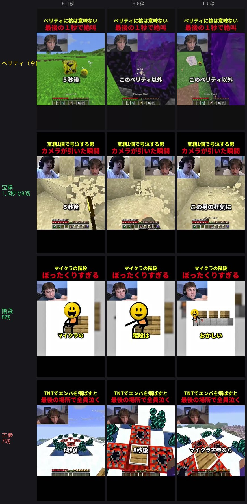
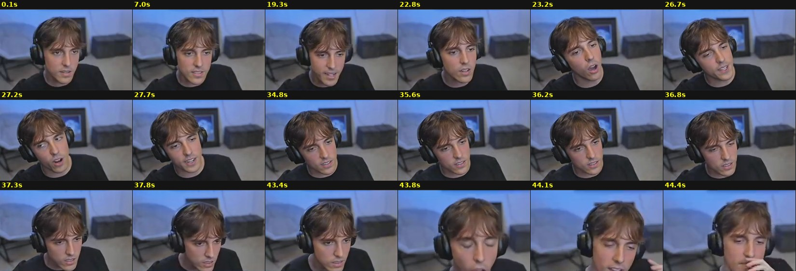

# ベリティの動画・完成版のチェック（2026-11-27）

対象：ユーザーの完成版（44.6秒・608×1080・30fps）。

**送られたファイルには音が入っていなかった**（アップロードのときに圧縮されて、音の線が消えていた）。そのため、この資料は**画と文字だけ**のチェック。ナレーション・吹き替え・効果音は、音の入ったファイルが届いてから確かめる。

---

## 1. 結論

- **フック（0〜2.5秒）は、決めた形どおり。** 採点の8項目（`hook_check.md`）を全部満たしている
- 画面の配置（上の黒帯のタイトル・左上のドクタードーナツ・白いナレーション字幕）は、みんくらの100万超え3本と同じ形
- **直すとよい所は4つ**（4章）。どれも小さな直し

---

## 2. フック（0〜2.5秒）

| 秒 | 画 | 字幕（白） |
|---|---|---|
| **0.000**（1コマ目） | ベリティが転がっているだけ。**核はまだない**。字幕もない | なし |
| 0.033〜0.2 | **核とベリティが並ぶ**。左上にドクタードーナツの顔。0.17秒で核が白く光る | 5秒後 |
| 0.8〜1.6 | ゲートに入る。1.1〜1.7秒にゲートの左で核とベリティがもう一度映る（**顔の箱に隠れていない**） | このベリティ以外 |
| 1.7〜2.5 | 紫から暗くなる | 全部消えます |
| 3.5〜4.4 | ネザーで待つ所 | 「ドカーン！！(爆発音)」（赤） |
| 7.0〜7.7 | クレーター → 浮いているベリティ（約束の答え。文字なしで見せる） | なし |

**採点（A〜H）**

| | 中身 | 判定 |
|---|---|---|
| A 0秒の画 | 人の顔（ドクタードーナツ）・核・ベリティの顔の3つ。宝箱（顔2つ・1.5秒で83%）と同じく、0秒に顔がある | ○ |
| B 1秒で通じる | 「5秒後」と核が同時に出る | ○ |
| C 見る人を絞らない | 略語・「古参なら」のような言葉がない | ○ |
| D 主語 | 「このベリティ」 | ○ |
| E 約束が短く、守られる | 「5秒後」→ 7.0秒（2秒遅れ。宝箱は1.9秒遅れ）。待つ間に「ドカーン！！」が出る | ○ |
| F 答えを言わない | 骸骨は最後まで見せない | ○ |
| G 短い | 字幕は0.03〜2.5秒（声が同じ長さなら、宝箱の2.7秒より短い） | ○（声は未確認） |
| H 落差 | 「ベリティ以外、全部消える」 | ○ |

**「ドカーン！！(爆発音)」はよい足し方**：
- ネザーで待つ間に、「上で爆発した」ことが分かる
- 3.5秒は、BGM のベースが入る所（元の9.3〜9.6秒＝この動画の3.5〜3.8秒）とほぼ同じ
- 前に案を出した「\*地上では今…\*」より、何が起きたかがはっきりしている

---

## 3. ドクタードーナツ

- 大きさは横幅の約45%（275×170）。**階段・古参と同じ大きさ**
  - 前に「2割まで」と書いたのは、こちらの見本の画面の切り方で測ったため
  - この動画は、ゲーム画面の切り方が違い、1.1〜1.7秒の核とベリティは顔の箱の下に出る。**隠れていない**
- **顔は動画で、出来事に合わせて動いている**
  - 23.2秒（レールガン）で口を開ける
  - **43.8〜44.4秒（骸骨）で、のけぞって口を手でおさえる**。上部タイトル「最後の1秒で絶叫」の答えが、人の反応で見える
- 水色のセリフ（26.6〜28.7秒「おい、今なにが起きてんだ！？」、34.6〜36.7秒「嘘だろ…」「これ本当にマイクラか！？」）
  - 27秒・36秒に口がよく動いているので、本人が何か言っている所に合わせて付けたように見える
  - **本人が実際に英語で言った言葉の訳なら、宝箱と同じ形でとてもよい**
  - 本人が言っていない言葉なら、本人の発言に見えてしまうので、赤の見出し（ツッコミ）にする方が安全

---

## 4. 直すとよい所（大事な順）

| # | 所 | 今 | 直し方 | 理由 |
|---|---|---|---|---|
| 1 | **36.7〜44.1秒** | **7.4秒、文字がない**（レーザー → 穴 → 飛び込む） | 41.5〜43.8秒あたりに赤で「\*穴の底を見に行くと…\*」（または、ドクタードーナツがこの間に何か言っていれば、その訳） | オチの直前で、何を見ればいいかが消える。上部タイトル「最後の1秒」への橋渡しにする |
| 2 | 14.5〜16.0秒 | 「ボクを閉じ込めて行っちゃうの？」が横幅の **10〜90%** まで広がる | 2行にする（「ボクを閉じ込めて／行っちゃうの？」）か、「ボクを閉じ込める気？」に縮める | ショートの右側の「高評価」ボタンの辺り（右の約1割）にかかる |
| 3 | 17.8〜19.0秒 | 「\*円型軌道法\*」 | 「\*空からTNTの雨\*」、技の名前の感じを残すなら「\*TNT軌道爆撃\*」 | ここは、TNT を何重もの輪に並べて空から落とす仕掛け。「軌道法」はふつうの言葉ではなく、1秒では伝わりにくい（「円形」の字も「円型」になっている） |
| 4 | 0.000秒 | 1コマ目だけ、核と字幕がない | 頭の1コマ（0.03秒）を消す。カバー（サムネ）も、核・ベリティ・顔が並ぶ0.1秒のコマにする | 見る人にはほぼ分からないが、カバーを1コマ目にしていると、核のない画になる |

**直さなくてよいもの**
- 「全部消えます」が白：100万超え3本も、ナレーションの字幕は全部白
- 骸骨の上の「\*うぉ！！！\*」：骸骨の顔にはかかっていない（胸のあたり）。ドクタードーナツの叫びなら、色を水色にそろえてもよい
- 44.6秒で骸骨のまま終わり、黒い画面もない

---

## 5. 前の資料の間違い（直した）

- `script.md` と `noads_cut.py` で「\*核爆弾 2発目\*」としていた所（この動画の17.4〜19.2秒）は、**2発目の核ではなかった**
  - 実際は、TNT を輪の形に何千個も並べて空から落とす仕掛け（拡大して確かめた）
  - ユーザーの「\*円型軌道法\*」の方が、中身には近い

---

## 6. 音が届いたら確かめること

1. ナレーションの長さ（2.5〜2.7秒に収まっているか）と、BGM に負けていないか
2. ナレーションの間、元の音を下げているか
3. 声どうしが重なっていないか（ベリティの3行・ドクタードーナツの2か所）
4. 「ドカーン！！」の効果音が、BGM のベースが入る所（3.5〜3.8秒）と合っているか
5. 最後の叫びが、骸骨の出る瞬間（43.9秒）と合っているか
6. 全体の音量（大きすぎて割れていないか）
